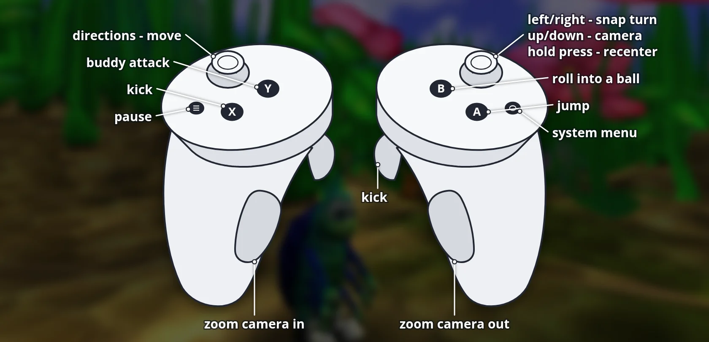

# Bugdom VR (Meta Quest / Pico) - Beta

Unofficial standalone-VR build of [Bugdom](https://github.com/jorio/Bugdom) (Pangea Software 1999,
modern port by Iliyas Jorio), running natively on Android-based headsets via OpenXR.

## Status

- Meta Quest 3: tested.
- Meta Quest 2 / Pro / 3S: should work (same runtime), not tested.
- Pico 4 / Neo 3: built in (Pico controller bindings, OpenXR launcher category), **not tested yet**.

## Install (sideload)

1. Enable developer mode on the headset and connect it via USB.
2. `adb install -r Bugdom-VR-1.3.5-beta1.apk`
3. Quest: App Library -> filter "Unknown Sources" -> Bugdom.
   Pico: Library -> Unknown sources -> Bugdom.

## Controls

| Controller | Action |
|---|---|
| Left stick | Move |
| Right stick left/right | Snap turn (30 deg) |
| Hold right stick click 1 s | Recenter view (forward + eye height) |
| A | Jump |
| B | Morph into ball |
| X / right trigger | Kick |
| Y | Buddy attack |
| Grip L / R | Zoom camera |
| Menu | Pause |
| Right controller laser | Point & click in menus |

## VR features

- Stereo rendering with a chase camera that keeps the horizon level.
- HUD on a floating panel; during gameplay the top and bottom info bars are moved toward
  the edges of your view so they don't cover the action.
- Automatic recenter on start, plus manual recenter (hold right stick click).
- Correct sRGB color output (no washed-out colors).

## Build

Requires Android SDK + NDK 27.2.12479018 and SDL3 source in `extern/SDL`:

    git clone --depth 1 --branch release-3.4.x https://github.com/libsdl-org/SDL extern/SDL
    cd android
    ./gradlew assembleRelease

Output: `android/app/build/outputs/apk/release/app-release.apk` (signed with the debug key, sideload only).

## License

Same as upstream Bugdom: CC BY-NC-SA 4.0. Non-commercial; derivatives must use the same license.
